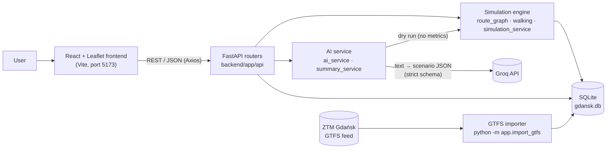

# WhatIf Mobility

[](https://github.com/soniabecz/whatif-mobility/actions/workflows/ci.yml)

**Ask "what if?" about Gdańsk's public transport and see the answer on the map.**
Describe a change to the tram and bus network in plain language, or build it with a
form, and WhatIf Mobility simulates how every journey in the city changes.

---

## Contents

1. [Project Overview](#1-project-overview)
2. [Features](#2-features)
3. [Technology Stack](#3-technology-stack)
4. [Architecture](#4-architecture)
5. [Local Setup and Installation](#5-local-setup-and-installation)
6. [API Documentation](#6-api-documentation)
7. [AI Integration](#7-ai-integration)
8. [AI-Assisted Development](#8-ai-assisted-development)
9. [Testing](#9-testing)
10. [Project Structure](#10-project-structure)
11. [Future Improvements](#11-future-improvements)
12. [Author](#12-author)

---

## 1. Project Overview

**WhatIf Mobility** is a web application for exploring hypothetical changes to a city's
public transport network. It runs on the real network of **ZTM Gdańsk**: trams and
buses, about 714 stations and 93 lines, imported from the operator's public GTFS
timetable.

**The problem.** Before a stop is closed for roadworks, a line is rerouted or a
service runs more often, it is hard to see who is affected and by how much. A change
on one street ripples through transfers and detours across the whole network.

**Purpose and users.** The app makes these effects visible and measurable for
transport planners, students, researchers and interested citizens. It is a
simulation and exploration tool, not a journey planner for live travel.

**Core What-if functionality.** A user types a request such as *"close the stop at
Brama Wyżynna"* or *"bus 199 every 10 minutes"*. An AI model (via Groq) **only
translates** the text into a structured list of changes, which the user checks. A
**deterministic simulation engine** then applies the changes to a copy of the network
and recomputes the fastest journey between every pair of stations (about 510,000
journeys). The engine computes every number shown; the AI never produces simulation
results.

## 2. Features

### Implemented

**Network visualisation**
- Full-screen Leaflet map of the Gdańsk network: every line in its own colour, stations
  as circles (drawn small when zoomed out so the lines stay visible).
- Legend with all 93 lines, their headways ("a bus every N min") and a filter box.
- Tooltips on a street list **every** line running on it (on Gdańsk 590 of 997 streets
  are shared, by up to 31 lines).
- The data source is credited on the map and in the legend, as the data's licence
  requires.

**Building scenarios** (up to 20 changes, applied in order)

| Change | What it does |
| --- | --- |
| Close stop | Nobody can board, alight or change there; vehicles drive through |
| Remove link | A link between two stops is removed (one or both directions) |
| Travel time | Sets a link's travel time |
| Frequency | Sets how often a line runs (a vehicle every 1–120 min) |
| Add link | An existing line also runs between two stops (extension or shortcut) |
| Add stop | Inserts a new stop into a line, placed by clicking the map |
| Add route | A new line through existing stops (up to 30), one way, both ways or as a loop |

Changes can be built with a **form** (stops and lines can be picked by clicking the
map) or from **plain language with the AI** (English or Polish). The AI can also edit
the current list ("remove the second change"), with an Undo button.

**Simulation results**
- Summary tiles: journeys slower, faster or impossible, and the average journey time
  before and after.
- Details: unchanged and newly possible journeys, total time change, largest
  increase, most affected stops, a chart of the biggest changes, and a table of the
  1,000 largest changed journeys.
- The map colours each station by impact (slower, faster, impossible, closed).
- **CSV export** of all changed journeys (computed by the backend).
- **AI summary** of the results in a few sentences. The backend inserts every number
  and rejects any text in which the AI wrote a number itself.

**Exploring and sharing**
- **Journey explorer**: one journey before and after, leg by leg, with lines, waiting,
  changes of bus and walks, drawn on the map.
- **Shareable link**: the address bar always encodes the current change list.
- **Saved scenarios** (stored in the database) and a **side-by-side comparison** of
  two scenarios.

### How a simulation works (summary)

1. The changes are validated and applied to a **copy** of the baseline network; the
   baseline is never modified.
2. For every ordered pair of stations the fastest journey is computed, both on
   today's network and after the changes. A journey's time is:
   time on board + waiting (half the headway, at every boarding) + 2 min per change of
   bus + walking.
3. Passengers may walk up to 1,000 m at the start or end, up to 500 m between two
   vehicles, or the whole way (5 km/h, straight-line distance × 1.3).
4. Passengers stay on a vehicle only along the line's real stop sequence (per
   direction). Turning round at a terminus is a change.
5. Before and after are compared journey by journey. The results are deterministic:
   the same scenario always gives the same numbers.

Details and assumptions are in [Architecture](#4-architecture).

### Not implemented (planned or out of scope)

- **No public deployment**: the app runs locally. Hosting, a request limit on the AI
  endpoint, a production map-tile provider and user accounts are planned (see
  [Future Improvements](#11-future-improvements)).
- **No passenger data**: every journey counts equally. Real demand is not modelled.
- **Frequency-based, not schedule-based**: waiting is half the headway taken from the
  morning peak, not exact departure times.
- **Simplified timetable**: each line uses its most frequent stop sequence per
  direction. Trips that leave it (e.g. some depot or branch runs) are left out, and
  the importer reports them.

## 3. Technology Stack

| Area | Technology | Purpose |
| --- | --- | --- |
| Frontend | **React 19**, **TypeScript 7**, **Vite 8** | UI, type safety, dev server and build |
| Styling | **Tailwind CSS 4**, lucide-react icons, Inter font | Layout and design tokens |
| HTTP client | **Axios** | One shared API client (`src/api/client.ts`) |
| Map | **Leaflet** + **React Leaflet**, OpenStreetMap tiles | Network and results on the map |
| Charts | **Recharts** | Chart of the biggest changes (loaded on demand) |
| Backend | **Python 3.11+**, **FastAPI**, **Uvicorn** | REST API |
| Validation | **Pydantic 2**, pydantic-settings | Request/response schemas, settings from `.env` |
| Database | **SQLite** + **SQLAlchemy 2** | Network, line patterns, saved scenarios |
| Graphs | **NetworkX**, **SciPy**, **NumPy** | Network graph; compiled all-pairs shortest paths; vectorised figures |
| AI | **Groq** API (`groq` SDK), model `openai/gpt-oss-120b` | Text → scenario changes; result summaries |
| Real data | **GTFS** feed of ZTM Gdańsk (own importer) | Stations, lines, travel times, headways |
| Backend tests | **pytest** (+ httpx/httpx2 for FastAPI's TestClient) | Unit and API tests |
| Frontend tests | **Vitest**, **Playwright** | Unit tests; end-to-end tests in Chromium |
| Quality | **oxlint**, `tsc`, GitHub Actions | Lint, type check, CI |

**Technical decisions worth noting**
- **The AI translates, the engine computes.** The AI's output is a scenario in the same
  format the form produces. It is validated and dry-run before the user sees it.
- **Route-aware graph.** Stations alone cannot tell whether a passenger changes
  vehicle. The graph therefore has a node for "on line L at stop S", so waiting and
  change penalties are counted exactly.
- **SciPy's compiled Dijkstra.** It computes 714 shortest-path searches at once in
  under a second; pure NetworkX took 15–18 s per simulation on the full city.
  Optimisations were checked against the previous version for byte-identical results.
- **Generated API types.** The frontend's TypeScript types are generated from the
  backend's OpenAPI schema (`openapi-typescript`), and CI fails if they are out of
  date.

## 4. Architecture

### Frontend / backend separation

The project has two independent applications that talk over a **REST API (JSON)**:

- `frontend/`: React single-page app on `http://localhost:5173`. All network calls go
  through one Axios instance whose base URL comes from `VITE_API_BASE_URL` (default
  `http://localhost:8000`).
- `backend/`: FastAPI on `http://localhost:8000`. CORS allows only the frontend's
  origin (`localhost:5173` / `127.0.0.1:5173`).



### Backend modules

Route handlers in `app/api/` stay thin; the business logic lives in `app/services/`.

| Module | Responsibility |
| --- | --- |
| `api/` | FastAPI routers: network, simulations (+ CSV), journeys, AI, saved scenarios, comparisons |
| `schemas/` | Pydantic models for every request and response (scenario changes, results, journeys, AI) |
| `models/` | SQLAlchemy tables: `stops`, `routes`, `connections`, `route_patterns`, `pattern_stops`, `network_source`, `saved_scenarios` |
| `services/network_service.py` | Loads the network from the database into a NetworkX graph |
| `services/route_graph.py` | Route-aware graph: stop nodes, platform nodes, board/alight/ride edges, compiled all-pairs search |
| `services/walking.py` | Walking layer added to the graph (walks at the start, between vehicles, at the end) |
| `services/simulation_service.py` | Applies a scenario to a copy, computes all journey times, compares, builds the figures (cached per network and settings) |
| `services/journey_service.py` | Journey explorer: one journey before/after, split into legs and walks |
| `services/comparison_service.py` | Compares two scenarios journey by journey |
| `services/ai_service.py`, `network_excerpt.py` | Text → scenario via Groq; for a big network the prompt contains only the relevant part |
| `services/summary_service.py` | AI summary with placeholders, numbers inserted by the backend |
| `services/gtfs_import.py` | GTFS feed → stations, lines, links, line patterns, headways |
| `services/export_service.py`, `scenario_store.py` | CSV export; saved scenarios |
| `seed/` | The small invented sample city, **used only as test data** |

### How the transport network is represented

- **In the database:** stations (`stops`), lines with headways (`routes`), directed
  links with a travel time per line (`connections`), and each line's stop sequences
  per direction (`route_patterns` + `pattern_stops`). Stations are GTFS stop posts
  grouped by name; posts more than 500 m apart are kept separate.
- **Network graph (NetworkX `DiGraph`):** stations are nodes, links are directed edges,
  and the edge weight is the travel time (`route_times` per line on each edge).
- **Route-aware graph (one per simulation):**
  - **Nodes:** stations, and platforms meaning "on line L at stop S, at position i of
    one of its stop sequences".
  - **Edges:** *board* (weight = half the headway + change penalty), *alight* (0) and
    *ride* (the line's travel time, only to the next position of the same sequence).
  - **Walking layer:** a few extra nodes per station, so walks are part of the same
    shortest-path search.

### Simulation engine

1. Build the route-aware graph from a **copy** of the baseline; the baseline is never
   modified.
2. Apply the changes in order: closing a stop removes the station node but keeps the
   platforms, so vehicles drive through. Links are removed or retimed, headways
   changed, and links, stops or lines added. Invalid changes fail with a clear message.
3. Compute the fastest time from every station to every other with SciPy's compiled
   Dijkstra. Today's network is computed once and cached, and recent scenarios are
   cached too.
4. Compare before and after journey by journey: slower, faster, impossible, newly
   possible, unchanged. Then compute averages, per-station impact, the most affected
   stations and the largest changes. All figures are deterministic.

On the full network a simulation takes about 1.5 s on a laptop. Comparing two
scenarios that were just run takes under 1 s.

## 5. Local Setup and Installation

These steps were run on macOS (Python 3.11.5, Node.js 24, npm 11) on a fresh clone of
the repository.

### Prerequisites

| Tool | Version | Check |
| --- | --- | --- |
| Python | **3.11 or newer** | `python3 --version` |
| Node.js | **22.12 or newer** (CI uses 24) | `node --version` |
| npm | comes with Node.js | `npm --version` |
| Git | any recent version | `git --version` |

On macOS, the `python3` that comes with Apple's command line tools can be older than
3.11: install a current Python (from python.org or Homebrew) and check that
`python3 --version` shows 3.11 or newer. Node.js 22.12+ is needed for the unit tests (Vitest 5). The app alone runs on
20.19+ (Vite 8). An internet connection is needed for the first setup: Python and npm
packages, and the Gdańsk timetable feed (about 25 MB). A Groq API key is **optional**: without it,
everything except the AI features works.

### Quick start (one command)

```bash
git clone https://github.com/soniabecz/whatif-mobility.git
cd whatif-mobility
./dev.sh
```

`dev.sh` does everything below automatically:
- checks Python 3.11+ and Node.js (it accepts Node 20+; see the versions above);
- creates `backend/.venv` and installs the packages (only when `requirements.txt` changed);
- creates `backend/.env` from the example;
- **imports the Gdańsk network on the first run**;
- installs the frontend packages and starts both servers.

Open **http://localhost:5173**. Press **Ctrl+C** to stop both servers.

### Manual setup, step by step

**Backend** (terminal 1)

1. Clone the repository and go to the backend:
   ```bash
   git clone https://github.com/soniabecz/whatif-mobility.git
   cd whatif-mobility/backend
   ```
2. Create and activate a virtual environment (macOS/Linux):
   ```bash
   python3 -m venv .venv
   source .venv/bin/activate        # the prompt now shows (.venv)
   ```
3. Install the dependencies:
   ```bash
   pip install -r requirements.txt
   ```
4. Configure environment variables:
   ```bash
   cp .env.example .env
   ```
   Optionally put your Groq key in `backend/.env` (`GROQ_API_KEY=...`, from
   https://console.groq.com/keys). `backend/.env` is git-ignored; never commit it.
5. Initialise the database by importing the Gdańsk network:
   ```bash
   python -m app.import_gtfs
   ```
   This downloads the feed to `backend/data/gtfs/` and creates `backend/gdansk.db`
   (about 45 s in total with the package install). Re-run it later to refresh the
   timetable; saved scenarios are kept.
6. Start the FastAPI server:
   ```bash
   uvicorn app.main:app --reload
   ```
   It listens on http://localhost:8000.

**Frontend** (terminal 2)

7. Go to the frontend and install the npm dependencies:
   ```bash
   cd whatif-mobility/frontend
   npm install
   ```
8. (Optional) Configure the API URL. The default `http://localhost:8000` works for
   local development. To change it, copy `.env.example` to `.env.local` and edit
   `VITE_API_BASE_URL`. Never put secrets in frontend env files: they end up in the
   browser.
9. Start the development server:
   ```bash
   npm run dev
   ```

### Local URLs

| What | URL |
| --- | --- |
| Web app | http://localhost:5173 |
| API | http://localhost:8000 |
| Swagger UI (interactive API docs) | http://localhost:8000/docs |
| ReDoc | http://localhost:8000/redoc |
| OpenAPI schema | http://localhost:8000/openapi.json |

When everything works, the header shows **● Live** and the network appears on the map.
Try: Stop → *Brama Wyżynna* → **Add to scenario** → **Run simulation**.

### Stopping the servers

- **Manual setup:** press **Ctrl+C** in each terminal; `deactivate` leaves the virtual
  environment.
- **`./dev.sh`:** **Ctrl+C** stops both.
- If a port stays busy, find the process with `lsof -iTCP:8000 -sTCP:LISTEN` (or
  `5173`) and stop it. The frontend port is fixed, because it is the only origin the
  backend allows.

### Configuration

Settings are read from `backend/.env` (see `backend/.env.example`). Restart the backend
after a change.

| Variable | Default | Purpose |
| --- | --- | --- |
| `GROQ_API_KEY` | *(none)* | Enables the AI features |
| `AI_MODEL` | `openai/gpt-oss-120b` | Groq model |
| `AI_TIMEOUT_SECONDS` | `30` | Timeout for AI calls |
| `TRANSFER_PENALTY_MIN` | `2` | Minutes added per change of vehicle (0–60) |
| `INCLUDE_WAITING` | `true` | Wait half the headway at every boarding |
| `WALKING_ENABLED` | `true` | Passengers may walk |
| `WALK_SPEED_KMH` | `5` | Walking speed (1–10) |
| `MAX_WALK_M` | `1000` | Longest walk at the start or end (100–3000) |
| `MAX_TRANSFER_WALK_M` | `500` | Longest walk between two vehicles (at most `MAX_WALK_M`) |
| `WALK_BETWEEN_OPEN_STOPS` | `true` | `false`: walk only from or to a closed stop |
| `WHATIF_DATABASE` *(shell variable)* | `gdansk.db` | Database file in `backend/` |

## 6. API Documentation

Interactive documentation, generated by FastAPI from the Pydantic schemas:
**http://localhost:8000/docs**.

| Method | Path | Description |
| --- | --- | --- |
| GET | `/api/health` | Health check |
| GET | `/api/stops` | All stations (id, name, lat, lon, activity) |
| GET | `/api/routes` | All lines (id, name, colour, headway) |
| GET | `/api/network` | Stations, lines, directed connections and the data source |
| POST | `/api/simulations` | Simulate a scenario: figures, per-station impact, the 1,000 largest changed journeys |
| POST | `/api/simulations/csv` | Every changed journey as CSV |
| POST | `/api/journeys` | One journey before and after a scenario, split into legs and walks |
| POST | `/api/comparisons` | Compare two scenarios journey by journey |
| POST | `/api/ai/interpret` | Plain-language text → scenario changes, for review (needs `GROQ_API_KEY`) |
| POST | `/api/ai/summary` | AI summary of a scenario's results; numbers inserted by the backend (needs `GROQ_API_KEY`) |
| GET | `/api/scenarios` | Saved scenarios (with a flag if one no longer fits the network) |
| POST | `/api/scenarios` | Save a scenario |
| GET / PUT / DELETE | `/api/scenarios/{scenario_id}` | Read, overwrite or delete a saved scenario |

Nothing in a simulation is stored. Results are always recomputed from the current
network.

The examples below are real responses from a local run (timetable of 14 Nov 2026,
shortened with `…`). Station ids such as `S1028` come from `GET /api/network`.

**`POST /api/simulations`**: close Brama Wyżynna

```bash
curl -X POST http://localhost:8000/api/simulations \
  -H "Content-Type: application/json" \
  -d '{"changes": [{"type": "close_stop", "stop_id": "S1028"}]}'
```

```json
{
  "scenario": { "changes": [{ "type": "close_stop", "stop_id": "S1028" }] },
  "summary": {
    "total_journeys": 509082,
    "unchanged": 433604,
    "slower": 75478,
    "faster": 0,
    "impossible": 0,
    "average_time_before_min": 67.1,
    "average_time_after_min": 67.5,
    "…": "…"
  },
  "changed_journeys": [
    { "origin_id": "S1028", "destination_id": "S1011", "time_before_min": 22.2,
      "time_after_min": 28.9, "change_min": 6.7, "status": "slower" },
    "…"
  ],
  "changed_journeys_total": 75478,
  "stop_impacts": [
    { "stop_id": "S100", "closed": false, "affected_journeys": 165,
      "impossible_journeys": 0, "average_change_min": 3.0 },
    "…"
  ],
  "most_affected_stop_ids": ["S1028", "S1832", "S1835", "S1834", "S1025"]
}
```

All seven change types (changes are applied in order; `both_directions` defaults to
`true`):

```json
{ "type": "close_stop", "stop_id": "S1028" }
{ "type": "remove_connection", "from_stop_id": "S1025", "to_stop_id": "S1013" }
{ "type": "change_travel_time", "from_stop_id": "S1025", "to_stop_id": "S1832", "travel_time_min": 6, "both_directions": false }
{ "type": "change_frequency", "route_id": "B199", "headway_min": 10 }
{ "type": "add_connection", "route_id": "…", "from_stop_id": "…", "to_stop_id": "…", "travel_time_min": 5 }
{ "type": "add_stop", "stop_id": "N1", "name": "…", "lat": 54.35, "lon": 18.65, "route_id": "…", "from_stop_id": "…", "to_stop_id": "…", "time_from_min": 1.5, "time_to_min": 2 }
{ "type": "add_route", "route_id": "R5", "name": "…", "color": "#123456", "headway_min": 8, "stop_ids": ["…", "…"], "travel_times_min": [4], "is_loop": false, "both_directions": true }
```

**`POST /api/journeys`**: one journey, before and after

```bash
curl -X POST http://localhost:8000/api/journeys \
  -H "Content-Type: application/json" \
  -d '{"origin_id": "S1835", "destination_id": "S15002",
       "changes": [{"type": "close_stop", "stop_id": "S1028"}]}'
```

```json
{
  "origin_id": "S1835",
  "destination_id": "S15002",
  "status": "slower",
  "change_min": 10.9,
  "before": { "travel_time_min": 47.9, "…": "…" },
  "after": {
    "travel_time_min": 58.8, "in_vehicle_min": 16.0, "wait_min": 24.1,
    "walk_min": 16.6, "transfers": 1, "transfer_penalty_min": 2.0,
    "legs": [
      { "route_id": "T9", "stop_ids": ["S1037", "S2103"], "travel_time_min": 2.0, "wait_min": 5.25, "…": "…" },
      { "route_id": "BN1", "stop_ids": ["S1004", "S1200", "…"], "travel_time_min": 14.0, "wait_min": 18.9, "…": "…" }
    ],
    "walks": [
      { "from_stop_id": "S1835", "to_stop_id": "S1037", "distance_m": 780.0, "minutes": 9.3, "before_leg": 0 },
      { "from_stop_id": "S2103", "to_stop_id": "S1004", "distance_m": 360.0, "minutes": 4.4, "before_leg": 1 },
      { "from_stop_id": "S1789", "to_stop_id": "S15002", "distance_m": 240.0, "minutes": 2.9, "before_leg": 2 }
    ]
  },
  "reason": null
}
```

**`POST /api/simulations/csv`**: same body as `/api/simulations`

```csv
origin_id,origin_name,destination_id,destination_name,status,time_before_min,time_after_min,change_min
S1835,Żuraw,S15002,Huenefelda,slower,47.9,58.8,10.9
```

**`POST /api/ai/interpret`**

```json
{ "text": "close Brama Wyżynna", "current_changes": [] }
```

With a key, the response has `status` (`"ok"` or `"unclear"`), the new `changes` list
and a `message`. Without `GROQ_API_KEY` the endpoint answers **503**:

```json
{ "detail": "The AI is not configured. Add GROQ_API_KEY to backend/.env and restart the backend. The scenario form still works." }
```

**`POST /api/comparisons`**: body `{"a": [changes…], "b": [changes…]}`. The response
contains both scenarios' summaries (`a`, `b`), the number of journeys `same`,
`a_faster` / `b_faster`, `only_possible_in_a` / `only_possible_in_b`,
`impossible_in_both` and the `largest_differences`.

## 7. AI Integration

**Implemented**, with Groq (`groq` Python SDK) and the model `openai/gpt-oss-120b`
(configurable with `AI_MODEL`).

### Natural language → scenario (`POST /api/ai/interpret`)

1. The backend builds a system prompt describing the network: stations, lines and
   links. For the full city, the prompt includes only the stations and lines the request
   mentions (matching Polish word forms, e.g. *Bramie → Brama*), to stay within the
   model's limits.
2. The model must answer in a **strict JSON schema** (Groq structured outputs): a list of
   operations on the current change list (add, remove or replace changes).
3. The backend checks the answer three times:
   - the schema;
   - the same Pydantic validation as the form;
   - a **dry run** that applies the changes to a copy of the network without computing
     any metrics.

   Unknown stops or missing links are caught here.
4. If the request is unclear, the AI asks a question instead of guessing (`status:
   "unclear"`).
5. The proposed changes appear in the normal change list. **The user reviews them and
   presses Run.**

The AI does **not** add new stops, because it would have to invent coordinates. It
points the user to the form instead.

### AI summary of results (`POST /api/ai/summary`)

The backend runs the simulation itself; it never trusts results sent by the browser.
It gives the model a fact sheet of computed values, each with a placeholder name. The
model writes text with placeholders (e.g. `{slower} journeys get slower`), and the
backend inserts the numbers. A text containing digits or number words is rejected;
after one retry the summary is withheld.

### What is AI and what is deterministic

| Done by the AI | Done by deterministic code |
| --- | --- |
| Understanding the user's request (EN/PL) | Validating and applying every change |
| Proposing changes in the scenario format | All shortest paths, times and figures |
| Wording a short summary | Every number in the summary, the CSV and the UI |

### API key security

- The key is read from `backend/.env` (`GROQ_API_KEY`), which is **git-ignored**; only
  `backend/.env.example` with an empty value is committed.
- In the settings the key is a Pydantic `SecretStr`, so it is never printed in logs or
  error messages.
- The key never reaches the browser: the frontend only calls the backend.
- Without a key the app works fully; only the AI features answer with 503.
- Note: on Groq's free tier, one request about the full city uses most of a minute's
  token allowance, so wait about a minute between AI requests.

## 8. AI-Assisted Development

AI tools were used openly throughout development:

- **Claude Code** (Anthropic): architecture proposals, the implementation plan
  (`docs/IMPLEMENTATION_PLAN.md`), backend and frontend implementation, tests,
  debugging, performance measurements and code explanations. Commits made with its help
  are marked `Co-Authored-By: Claude` (nearly all of them, see `git log`).
- **Cursor**: development environment for navigating the code, editing and reviewing
  changes.

**How the work was controlled.** The rules are in `CLAUDE.md`: inspect the code, explain
a plan, and wait for approval before substantial changes. Each step followed the same
cycle: design proposal → approval → implementation with tests → review of the result →
commit only on explicit approval.

All changes to the simulation model were checked against the previous version:
- byte-identical results for refactorings and speed-ups;
- every difference explained for intended model changes.

Generated code was reviewed, tested (unit, API and end-to-end tests, CI on every push)
and adapted during development.

## 9. Testing

| Suite | Command | Count |
| --- | --- | --- |
| Backend (pytest) | `cd backend && source .venv/bin/activate && pytest` | 410 tests |
| Frontend unit (Vitest) | `cd frontend && npm test` | 137 tests |
| End-to-end (Playwright, Chromium) | `cd frontend && npm run test:e2e` | 20 tests in 13 files |
| Lint / type check / build | `cd frontend && npm run lint && npm run build` | n/a |

Before the first end-to-end run, download the browser once:
`cd frontend && npx playwright install chromium`. Playwright starts its own backend and
frontend. **Stop the app first** if it is running (both use ports 8000 and 5173); the
tests stop with a clear message otherwise.

**What is covered**
- **Backend:**
  - simulation rules and metrics: every change type, waiting, change penalties, walking,
    line patterns, demand weighting;
  - the graph and the compiled shortest paths (checked against NetworkX);
  - the journey explorer, which must agree with the simulation;
  - saved scenarios, comparisons and the CSV;
  - the GTFS importer (on a hand-made feed);
  - the AI layer with a fake model (prompt, validation, edits, summaries that may not
    contain numbers);
  - the API endpoints, settings and database setup.
- **Frontend unit:** pure helpers in `src/lib` (scenario drafts, share links, map
  helpers, impact texts, journey plans, comparisons).
- **End-to-end:** the main flows in a real browser against the real backend: closing
  a stop (checking the tiles against the backend's numbers), map selection, share links,
  CSV, each form tab, adding stops and routes, walking, AI editing and summary (the
  tests answer the AI endpoints themselves, since CI has no key), saved scenarios and
  comparison.

**Test data.** The tests use a small **invented sample city** (16 stops, 4 lines) with
stable, hand-checkable numbers, not the Gdańsk feed, which changes daily. Backend tests
seed it into an in-memory database; Playwright seeds it into `backend/e2e-sample.db`.
`python -m app.seed` refuses to write anywhere else.

**Continuous integration.** Every push to `main` runs
[`.github/workflows/ci.yml`](.github/workflows/ci.yml) on GitHub Actions:
- the backend tests;
- frontend lint, unit tests, type check and build;
- a check that the generated API types are up to date;
- the end-to-end tests.

No secrets are needed in CI.

**API types.** After changing a backend schema, regenerate the frontend types:
`cd backend && python -m app.export_openapi`, then
`cd ../frontend && npm ci --prefix tools/openapi && npm run gen:types`. The generator
lives in `frontend/tools/openapi/` because it needs TypeScript 5.

## 10. Project Structure

```
whatif-mobility/
├── backend/
│   ├── app/
│   │   ├── api/            # FastAPI routers (thin: call the services)
│   │   ├── models/         # SQLAlchemy tables
│   │   ├── schemas/        # Pydantic request/response models
│   │   ├── services/       # Business logic: graph, walking, simulation, journeys,
│   │   │                   #   comparison, AI, GTFS import, CSV, saved scenarios
│   │   ├── seed/           # Invented sample city (test data only)
│   │   ├── config.py       # Settings from environment / backend/.env
│   │   ├── database.py     # SQLite engine (backend/gdansk.db by default)
│   │   ├── import_gtfs.py  # `python -m app.import_gtfs`: import Gdańsk
│   │   ├── export_openapi.py
│   │   └── main.py         # FastAPI app, CORS, routers
│   ├── tests/              # pytest suite
│   ├── requirements.txt    # Pinned Python dependencies
│   └── .env.example        # Documented settings (copy to .env)
├── frontend/
│   ├── src/
│   │   ├── api/            # Axios client and API calls
│   │   ├── components/     # Map, legend, scenario form, results, explorer, AI input, …
│   │   ├── lib/            # Pure helpers (with Vitest tests)
│   │   ├── types/          # Type aliases over the generated api.gen.ts
│   │   └── App.tsx         # Layout and app state
│   ├── e2e/                # Playwright end-to-end tests
│   ├── tools/openapi/      # OpenAPI → TypeScript type generator
│   ├── openapi.json        # Backend schema snapshot (for the types)
│   ├── package.json
│   └── vite.config.ts
├── docs/
│   └── IMPLEMENTATION_PLAN.md  # Plan, decisions, status and session log
├── .github/workflows/ci.yml
├── CLAUDE.md               # Project rules for AI-assisted development
├── dev.sh                  # One-command setup and start
└── README.md
```

Not in Git: `backend/.env`, `backend/*.db`, `backend/data/gtfs/` (the downloaded feed)
and `node_modules/`.

## 11. Future Improvements

- **Public deployment:** choose a hosting target, add a request limit on the AI
  endpoint, use a production map-tile provider (the public OpenStreetMap tile server is
  only suitable for development) and add user accounts.
- **Speed:**
  - write the CSV directly from the computed arrays (about 1.6 s now);
  - run the shortest-path search in worker processes (needs more than one CPU on the
    host).
- **Real demand:** weigh journeys by passenger data (the engine already supports
  per-station weights), if such data becomes available.
- **Timetable fidelity:** keep trips that leave a line's main stop sequence (branches,
  depot runs), and use exact departure times instead of average waiting.
- **AI:** handle relative changes on links whose two directions have different travel
  times, which the model does not always follow.
- **Visualisation:** draw lines sharing a street side by side instead of on top of each
  other.
- **Scheduled data refresh:** re-import the timetable automatically, since the feed is
  republished daily.

## 12. Author

**[Your Name Surname]**: *add your name, and optionally a contact or LinkedIn profile.*

### Data and licences

Timetable data: **Zarząd Transportu Miejskiego w Gdańsku**
([open data](https://ckan.multimediagdansk.pl/dataset/tristar),
http://www.ztm.gda.pl/otwarty_ztm), Creative Commons Attribution and the terms of use
of "Otwarte dane ZTM w Gdańsku". The app shows the publisher and the data's creation
and download dates, as the terms require. Map tiles © OpenStreetMap contributors.
